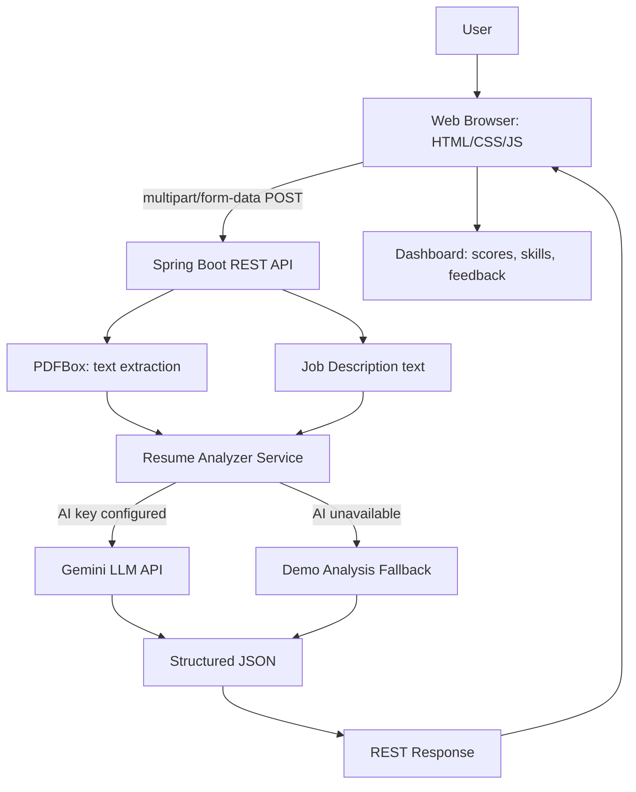

# AI Resume Analyzer

A web application that analyzes a PDF resume (and, optionally, a target
job description) using an AI model, and returns a scored, structured feedback dashboard:
overall score, ATS compatibility, detected/missing skills, keyword matching, strengths,
weaknesses, section-by-section analysis, and improvement suggestions.

**Developed by:** Atharva Joshi & Ashwin Mukati (Section: 5E)

---

## A. What was built

A single Spring Boot application that serves both the backend REST API and a plain
HTML/CSS/JS frontend (no separate frontend server, no React). The flow:

1. User uploads a PDF resume (drag-and-drop or browse) and optionally pastes a job description.
2. The backend extracts text from the PDF with Apache PDFBox.
3. The extracted text (+ job description) is sent to an LLM (Google Gemini) with a structured prompt.
4. The AI returns strict JSON matching a predefined schema.
5. The backend validates that JSON and returns it to the browser.
6. The frontend renders it as a dashboard: scores, skills, keyword match, strengths/weaknesses,
   section analysis, and suggestions.

If the AI key isn't configured yet, or the AI call fails for any reason, the app automatically
falls back to a **local, rule-based "Demo analysis mode"** so the project never breaks during
a live demo - it's clearly labeled as demo mode, never disguised as a real AI result.

## B. Technology stack

| Layer            | Technology                                  |
|-------------------|----------------------------------------------|
| Backend           | Java 21, Spring Boot 3.3                     |
| Build tool        | Maven                                        |
| PDF extraction    | Apache PDFBox 3.x                            |
| AI provider       | Google Gemini API (`gemini-1.5-flash`)       |
| Frontend          | HTML, CSS, vanilla JavaScript (served by Spring Boot's `static/` folder) |
| JSON              | Jackson (bundled with Spring Boot)           |
| Testing           | JUnit 5, Spring Boot Test, MockMvc           |

No database, no authentication, no Docker, no microservices - deliberately kept simple.

## C. Project structure

```text
ai-resume-analyzer/
├── src/main/java/com/example/resumeanalyzer/
│   ├── ResumeAnalyzerApplication.java   # main() - starts Spring Boot
│   ├── controller/ResumeController.java # POST /api/analyze
│   ├── service/
│   │   ├── PdfExtractionService.java    # PDFBox text extraction + validation
│   │   ├── AIAnalysisService.java       # Builds prompt, calls Gemini, parses JSON
│   │   ├── DemoAnalysisService.java     # Deterministic fallback ("Demo analysis mode")
│   │   └── ResumeService.java           # Orchestrates the above
│   ├── model/
│   │   ├── AnalysisResult.java          # The structured analysis schema
│   │   └── ApiResponse.java             # {success, analysis | error} envelope
│   ├── config/AIConfig.java             # Reads AI_API_KEY etc. from properties
│   └── exception/                       # Custom exceptions + global handler
├── src/main/resources/
│   ├── application.properties
│   └── static/                          # index.html, style.css, script.js (the frontend)
├── src/test/java/...                    # Unit + integration tests
├── sample-data/                         # sample-resume.pdf/.txt + sample-job-description.txt
├── .env.example
├── .gitignore
└── pom.xml
```

## D. How to run it (Windows + IntelliJ IDEA)

### Prerequisites
- Java 21 (JDK) installed - check with `java -version` in Command Prompt.
- Maven (IntelliJ can use its own bundled Maven, or install separately).
- A free Gemini API key (see section E) - optional to *start* the app, required for real AI analysis.

### Option 1: IntelliJ IDEA (recommended for the demo)

1. Open IntelliJ IDEA → **Open** → select the `ai-resume-analyzer` folder.
2. IntelliJ detects `pom.xml` and imports it as a Maven project automatically. Wait for the
   Maven dependencies to download (bottom-right progress bar) - this needs a normal internet
   connection.
3. Set your API key so the run configuration can see it:
   - **Run → Edit Configurations** → select (or create) the `ResumeAnalyzerApplication` run config.
   - Under **Environment variables**, add: `AI_API_KEY=your_real_key_here`.
4. Open `ResumeAnalyzerApplication.java`, click the green ▶ Run button next to `main()`.
5. Once you see `Started ResumeAnalyzerApplication` in the console, open your browser at:
   **http://localhost:8080**

### Option 2: Command line (Windows Command Prompt / PowerShell)

```text
cd ai-resume-analyzer
set AI_API_KEY=your_real_key_here
mvn spring-boot:run
```

Then open **http://localhost:8080** in your browser.

> If `mvn` isn't recognized, either install Maven and add it to your PATH, or run the project
> through IntelliJ instead (Option 1), which bundles its own Maven.

## E. How to configure the AI API

1. Get a free Gemini API key from **https://aistudio.google.com/app/apikey** (sign in with a
   Google account, click "Create API key").
2. Never paste the key directly into any Java file. Instead:
   - **IntelliJ**: Run → Edit Configurations → Environment variables → `AI_API_KEY=<your key>`.
   - **Command line**: `set AI_API_KEY=<your key>` (Windows) before running `mvn spring-boot:run`.
   - Or copy `.env.example` to `.env`, fill in the real key, and load it into your shell/IDE's
     environment before starting the app (the app itself doesn't read `.env` files directly -
     it reads the `AI_API_KEY` environment variable via `application.properties`).
3. `.env` is already in `.gitignore`, so it will never be committed to GitHub.
4. If you forget to set the key, the app still starts normally - it just runs every analysis
   in **Demo analysis mode** instead of failing.

## F. How to test it

Automated tests:

```text
mvn test
```

This runs:
- `PdfExtractionServiceTest` - valid PDF, empty file, non-PDF file, oversized file, scanned/image-only PDF.
- `AIAnalysisServiceTest` - well-formed AI JSON, markdown-fenced JSON, out-of-range score clamping,
  malformed JSON, missing required fields.
- `DemoAnalysisServiceTest` - fallback scoring, skill detection, job-match keyword logic.
- `ResumeControllerTest` - end-to-end `/api/analyze` calls (valid PDF, non-PDF rejection, missing file).

Manual testing:
1. Start the app (section D).
2. Open http://localhost:8080.
3. Upload `sample-data/sample-resume.pdf` (or your own resume).
4. Optionally paste the contents of `sample-data/sample-job-description.txt` into the job
   description box.
5. Click **Analyze Resume** and confirm the dashboard renders scores, skills, and feedback.
6. Try uploading a `.txt` file to confirm you get the friendly "Please upload a PDF resume" error.
7. Try analyzing without setting `AI_API_KEY` to confirm "Demo analysis mode" appears and the
   app still works end-to-end.

## G. What to demonstrate during the college presentation (5-10 minutes)

1. **(1 min)** Briefly explain the problem: manually reviewing a resume against ATS/job-fit
   criteria is slow; this tool automates a first pass.
2. **(1 min)** Show the architecture diagram (section on Architecture below) and name the layers:
   frontend → REST API → PDF extraction → AI → structured JSON → dashboard.
3. **(2 min)** Live demo: upload `sample-data/sample-resume.pdf`, paste the sample job description,
   click Analyze. Walk through the dashboard: overall score, ATS score, job match %, skills,
   strengths/weaknesses, section analysis, suggestions.
4. **(1 min)** Show an error case: upload a `.txt` file → friendly error message, no crash.
5. **(1 min)** Open `AIAnalysisService.java` briefly and show the system prompt - explain that the
   AI is instructed to return **strict JSON** and never fabricate information.
6. **(1 min)** Mention the demo fallback: if the AI API is down or quota is exceeded, the app
   still works using local rule-based checks, clearly labeled "Demo analysis mode".
7. **(1 min)** Wrap up with future scope (see below) and take questions.

## H. How the AI part works

```text
PDF Upload
   ↓
PDFBox extracts plain text
   ↓
Backend builds a structured prompt:
  - System instructions (rubric, "return only JSON", "never fabricate")
  - Resume text
  - Optional job description
   ↓
Prompt sent to Gemini API (POST request, JSON body)
   ↓
Gemini responds with JSON matching our schema
   ↓
Backend parses + validates the JSON (Jackson)
   ↓
If parsing/validation fails → clear error OR demo fallback
   ↓
Structured result returned to frontend as JSON
   ↓
JavaScript renders the dashboard (scores, chips, lists)
```

In beginner terms: instead of asking the AI "what do you think of this resume?" and hoping for
a nicely-formatted answer, we tell it *exactly* what shape of answer we want (a JSON object with
specific fields), and we validate that it actually followed instructions before trusting the
result. This is called **structured output** / **prompt engineering**, and it's what makes the
AI's response safe to plug directly into a UI instead of just displaying raw text.

### Architecture diagram



## I. Likely viva questions

1. **What is an LLM?**
   A Large Language Model - a machine learning model trained on huge amounts of text that can
   understand and generate natural language, used here to read and evaluate resume content.

2. **What is prompt engineering?**
   The practice of carefully wording instructions to an AI model so it produces a reliable,
   specific, and correctly-formatted response - here, a strict JSON schema instead of free text.

3. **Why use PDFBox?**
   It's a mature, open-source Java library for reading and extracting text from PDF files without
   needing an external service.

4. **Why use Spring Boot?**
   It lets us build a REST API and serve a frontend from one Java application quickly, with
   built-in dependency injection, validation, and error handling.

5. **How does the frontend communicate with the backend?**
   The browser JavaScript calls `fetch("/api/analyze", { method: "POST", body: formData })` and
   receives a JSON response, which is then rendered into the page dynamically (no page reload).

6. **What is a REST API?**
   An architectural style where the server exposes resources/actions over HTTP endpoints
   (here, `POST /api/analyze`) that accept and return structured data (JSON).

7. **How is the resume analyzed?**
   Text is extracted from the PDF, sent to an LLM with a structured prompt and scoring rubric,
   and the LLM's JSON response is parsed into scores, skills, strengths, weaknesses, and suggestions.

8. **How is the ATS score calculated?**
   The AI estimates it based on formatting/structure signals (standard headings, presence of
   contact info, absence of tables/graphics, etc.) - it's explicitly labeled as an *estimate*,
   not a real ATS vendor's scoring algorithm.

9. **Why use JSON?**
   It's a lightweight, structured, language-independent format that both the Java backend and
   JavaScript frontend can easily produce and consume.

10. **How is the API key protected?**
    It's read from an environment variable (`AI_API_KEY`), never hard-coded in source, and never
    included in error messages or logs; `.env` is excluded from version control via `.gitignore`.

11. **What happens if the AI API fails?**
    The app catches the failure and either shows a friendly error or - if fallback is enabled -
    switches to a clearly-labeled local "Demo analysis mode" instead of crashing.

12. **What are the limitations?**
    Text-only PDFs (no OCR for scanned resumes), no DOCX support, scores are AI estimates (not
    official ATS scores), and analysis quality depends on the LLM provider.

13. **What is the difference between AI analysis and traditional programming?**
    Traditional programming (file validation, PDF parsing, HTTP routing) follows fixed,
    deterministic rules written by the developer. AI analysis (judging resume quality, generating
    suggestions) uses a trained model to produce context-dependent output that isn't hard-coded.

14. **How could this project be improved in the future?**
    See the Future Scope section below (DOCX support, OCR, resume history, multiple AI providers, etc.).

15. **Why is there a "Demo analysis mode" instead of just failing?**
    So the project can still be demonstrated live even without internet access or a valid API
    key - it's honestly labeled, not disguised as a real AI response.

16. **How is malformed AI output handled?**
    The backend tries to parse the AI's response as JSON matching our schema; if parsing fails or
    required fields (like `overallScore`) are missing, it throws a caught exception and either
    shows an error or falls back to demo mode - it never lets bad JSON crash the app or reach the UI unvalidated.

17. **Why cap the resume text length sent to the AI?**
    To keep the prompt small, keep costs/latency reasonable, and avoid provider request-size
    limits, while still preserving the vast majority of a typical resume's content.

18. **How is file upload validated?**
    Content-type/extension check for PDF, a file-size check (5 MB limit, enforced both client-side
    and server-side), and a check that meaningful text was actually extracted (to catch scanned/
    image-only PDFs).

19. **Why no database?**
    The app is stateless by design - each request is analyzed independently and nothing needs to
    persist between requests, which keeps the project simpler to run and explain.

20. **Why no login/authentication?**
    It's out of scope for a resume-analysis demo tool; adding it would add complexity without
    adding to the core learning objective of this project (AI integration + full-stack basics).

## Future scope

These are intentionally **not implemented** in this version, to keep it a focused college project:

- DOCX resume support (currently PDF-only)
- OCR for scanned/image-based resumes
- User accounts and resume analysis history
- Support for multiple AI providers (OpenAI, Claude, etc.) with a provider-selection setting
- AI-assisted resume rewriting/rephrasing suggestions
- Job recommendation based on detected skills
- LinkedIn profile import
- Resume template generation
- Cloud deployment (e.g. Render, Railway, AWS)
- A more advanced, multi-signal ATS simulation

## Privacy note

Uploaded resumes are processed in memory for the duration of a single request and are not
written to disk or stored in a database - once the response is returned, the file is discarded.
No personal information from resumes is logged.
